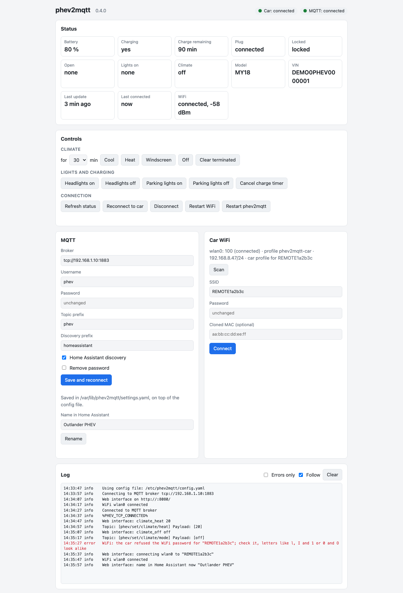

# phev2mqtt-nxt

Connects a Mitsubishi Outlander PHEV (or Eclipse Cross PHEV) to MQTT and Home Assistant,
over the car's own WiFi. A fork of [buxtronix/phev2mqtt](https://github.com/buxtronix/phev2mqtt).

<picture>
  <source media="(prefers-color-scheme: dark)" srcset="docs/web-interface-dark.png">
  
</picture>

## What it does

 * Shows the battery, charging, plug, doors, locks, lights and climate in Home Assistant
   (or anything else that speaks MQTT)
 * Pre-heats or cools the car, switches the lights and cancels the charge timer
 * Tells you whether the car is connected, how strong its WiFi is, and when it last
   connected
 * Has a web interface for the status, the controls, the setup and the log

Tested on an Outlander PHEV MY14 and MY18 and an Eclipse Cross (2022).

## Install

On a Raspberry Pi (any model) or another machine with Debian, Ubuntu or Raspberry Pi OS,
and a WiFi adapter within reach of the car:

```
version=0.5.0
deb=phev2mqtt_${version}_$(dpkg --print-architecture).deb
base=https://github.com/athomasse/phev2mqtt-nxt/releases/download/v$version
curl -fLO "$base/SHA256SUMS" -fLO "$base/$deb"
sha256sum -c --ignore-missing SHA256SUMS
sudo apt install "./$deb"
```

Turn on the web interface in `/etc/phev2mqtt/config.yaml` (`sudoedit` it):

```
web_listen: ":8080"
web_password: "something long"
```

Then start phev2mqtt and open `http://<machine>:8080` (any user name, that password):

```
sudo systemctl enable --now phev2mqtt
```

## Configure

In the web interface:

1. **Car WiFi**: the car's network (*REMOTExxxxxx*) and its password, which come with the
   car. This needs NetworkManager; without it, see the examples in
   `/usr/share/doc/phev2mqtt/examples/`.
2. **MQTT**: your broker, e.g. `tcp://192.168.1.10:1883`, with its user name and
   password.
3. Optionally the car's **name in Home Assistant**.

Then register with the car, once. Put the car into registration mode ("Setup Your
Vehicle" in the
[Mitsubishi instructions](https://www.mitsubishi-motors.com/en/products/outlander_phev/app/remote/)),
and within 5 minutes run:

```
sudo systemctl stop phev2mqtt
phev2mqtt client register
sudo systemctl start phev2mqtt
```

The car talks to one client at a time, so keep the Mitsubishi app disconnected. If the
WiFi refuses the password, check letters that look alike, like `l`, `I` and `1`.

All settings, with comments, are in `/etc/phev2mqtt/config.yaml`; the log is in
`journalctl -u phev2mqtt` and in the web interface.

## Home Assistant

The car shows up as a device by itself, through MQTT discovery, once phev2mqtt has
connected to it: search for "phev" in your entities.


<details>
<summary>MQTT topics</summary>

Published, under the prefix `phev` (`mqtt_topic_prefix`):

| Topic | Value |
|---|---|
| phev/available | Connected to the car: *online* or *offline* |
| phev/connection/last_connected, last_disconnected | When the car last connected and disconnected |
| phev/wifi/state, phev/wifi/signal | The car's WiFi: *connected* or *disconnected*, and the signal in dBm |
| phev/battery/level | Battery level, in percent |
| phev/charge/charging, plug, remaining | Charging *on*/*off*, plug *connected*/*unplugged*, minutes left |
| phev/climate/state | Climate *off*, *heat*, *cool*, *windscreen* or *terminated* |
| phev/climate/[cool, heat, windscreen] | *on* or *off* |
| phev/door/locked | *closed* when locked, *open* when not |
| phev/door/driver, front_passenger, rear_left, rear_right, bonnet, boot | *open* or *closed* |
| phev/lights/head, parking, hazard, interior | *on* or *off* |
| phev/vin, phev/registrations | The VIN, and the number of clients registered with the car |
| phev/register/[register] | Raw register values, in hex |

Commands:

| Topic | Payload |
|---|---|
| phev/set/climate/[cool, heat, windscreen] | Minutes: 10, 20 or 30 |
| phev/set/climate/mode | *off* |
| phev/set/headlights, parkinglights | *on* or *off* |
| phev/set/cancelchargetimer | Anything |
| phev/connection | *on*, *off* or *restart* (reconnect to the car) |
| phev/restart | Anything: restarts phev2mqtt |
| phev/set/register/[register] | A raw register value, in hex |

</details>

For how the car's protocol works, see the [protocol documentation](protocol/README.md).

## Credits

phev2mqtt was written by **Ben Buxton** ([@buxtronix](https://github.com/buxtronix)),
who reverse engineered most of the protocol, and improved by the contributors to
[buxtronix/phev2mqtt](https://github.com/buxtronix/phev2mqtt/graphs/contributors):
[@zivillian](https://github.com/zivillian), who cracked the XOR security algorithm
([#16](https://github.com/buxtronix/phev2mqtt/issues/16)),
[@altserg](https://github.com/altserg), [@gmta](https://github.com/gmta),
[@nagisa](https://github.com/nagisa), [@martingjohn](https://github.com/martingjohn),
[@IceEyz](https://github.com/IceEyz), [@gnyman](https://github.com/gnyman) and
[@StMond](https://github.com/StMond). This fork also includes upstream pull requests by
[@Will-Honor](https://github.com/Will-Honor), [@lazytesting](https://github.com/lazytesting),
[@Grisu930](https://github.com/Grisu930) and [@altserg](https://github.com/altserg).
It was inspired by [phev-remote](https://github.com/phev-remote) by
[@papawattu](https://github.com/papawattu).

This fork is maintained by Andre Thomasse ([@athomasse](https://github.com/athomasse)).
Issues and pull requests are welcome.

## Licence

GNU General Public License, version 3 or later; see [LICENSE](LICENSE).
Copyright 2021 Ben Buxton <bbuxton@gmail.com> and the contributors.
